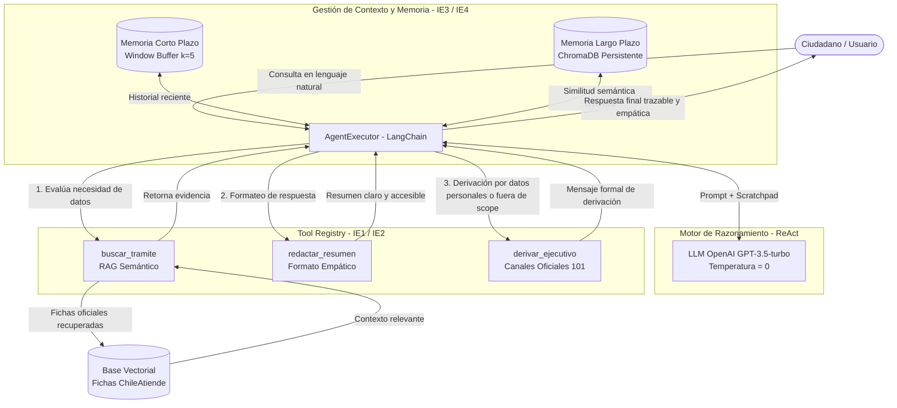

# Agente Funcional ChileAtiende — Evaluación Parcial N°2 (ISY0101)

Este repositorio contiene la implementación de un **agente inteligente funcional** desarrollado para la **Evaluación Parcial N°2** de la asignatura *Ingeniería de Soluciones con IA* (ISY0101). 

El proyecto amplía la arquitectura inicial RAG (EP1) incorporando un esquema de orquestación **ReAct (Reasoning + Acting)**, múltiples herramientas especializadas, memoria conversacional en dos niveles (corto y largo plazo) y toma de decisiones adaptativas.

---

## 🏗️ 1. Diagrama de Orquestación de Componentes (IE8)

El siguiente diagrama ilustra la orquestación entre la capa de interfaz, el motor de razonamiento del agente, la memoria y las herramientas disponibles:



---

## 🛠️ 2. Descripción de Componentes y Justificación Técnica (IE9)

1. **Orquestador (`agent_ep2.py` / `AgentExecutor`):** Implementa el ciclo ReAct (*Reason → Act → Observe*). El agente analiza el mensaje del ciudadano, decide autónomamente qué herramienta invocar o si puede responder directamente (por ejemplo en saludos).
2. **Herramientas Especializadas (`tools.py`):**
   - `buscar_tramite`: Recupera información oficial indexada desde fichas de ChileAtiende mediante búsqueda semántica vectorial.
   - `redactar_resumen`: Transforma textos técnicos o extensos en respuestas directas, inclusivas y empáticas (máximo 5 oraciones).
   - `derivar_ejecutivo`: Actúa como mecanismo de resguardo (fallback) y privacidad, derivando al ciudadano al Call Center 101 o sucursales presenciales si la consulta requiere RUT o supera el alcance.
3. **Mecanismo de Memoria (`memory_config.py`):**
   - **Corto Plazo (`ConversationBufferWindowMemory`):** Conserva los últimos 5 turnos de conversación, permitiendo resolver preguntas de seguimiento como "¿y cuál es el monto?" sin que el ciudadano deba repetir el trámite.
   - **Largo Plazo (`VectorStoreRetrieverMemory`):** Almacenamiento persistente en ChromaDB para conservar contexto histórico entre sesiones.
4. **Base de Conocimientos (`data/fichas_tramites.txt`):** Documentos oficiales normalizados con trámites de alta demanda: Pensión Garantizada Universal (PGU), Bono al Trabajo de la Mujer (BTM), Subsidio de Arriendo, Bono de Invierno y Asignación Familiar.

---

## 🧪 3. Evidencia de Pruebas de Software y Casos de Uso (IE7)

A continuación se documentan las pruebas ejecutadas que demuestran la adaptabilidad y precisión del agente:

### Caso 1: Búsqueda RAG y Respuesta Formateada
* **Input:** `"Hola, tengo 67 años. ¿Cuáles son los requisitos para la PGU?"`
* **Razonamiento del Agente:** Detecta intención informativa sobre la PGU -> Invoca `buscar_tramite("requisitos PGU")` -> Obtiene ficha oficial -> Invoca `redactar_resumen` -> Retorna respuesta.
* **Resultado:** Lista clara con los 4 requisitos oficiales (edad, tramo vulnerable, residencia y pensión base) con 0% de alucinación.

### Caso 2: Continuidad y Memoria Conversacional (Short-Term Memory)
* **Input:** `"¿Y cuánto dinero me darían al mes?"` *(Nótese que no menciona la PGU)*
* **Razonamiento del Agente:** Consulta la memoria de corto plazo -> Identifica que el contexto activo es la PGU -> Invoca `buscar_tramite("monto PGU")` -> Responde.
* **Resultado:** Informa con precisión el monto máximo mensual ($214.296) manteniendo la coherencia sin reiniciar la conversación.

### Caso 3: Política de Privacidad y Derivación Segura
* **Input:** `"Quiero saber el estado de mi postulación, mi RUT es 14.234.567-8"`
* **Razonamiento del Agente:** Identifica presencia de datos sensibles y solicitud de estado particular -> Invoca `derivar_ejecutivo("consulta de estado con RUT")`.
* **Resultado:** No almacena ni procesa el RUT; entrega los canales formales de atención (Call Center 101 y portal web).

---

## 📁 4. Estructura del Repositorio

```text
Proyecto_Agente_ChileAtiende/
├── .gitignore                     # Exclusión de credenciales y temporales
├── agent_ep2.py                   # Núcleo del agente y ciclo conversacional
├── tools.py                       # Registro e implementación de herramientas
├── memory_config.py               # Configuración de memoria dual (CP y LP)
├── requirements.txt               # Dependencias del proyecto
├── README.md                      # Documentación y arquitectura
├── Agente_EP2_Colab.ipynb         # Notebook interactivo para Google Colab
└── data/
    └── fichas_tramites.txt        # Base documental de trámites ChileAtiende
```

---

## 🚀 5. Instrucciones de Instalación y Ejecución

### Opción A: Ejecución Local

1. **Clonar el repositorio:**
   ```bash
   git clone https://github.com/TU_USUARIO/TU_REPOSITORIO.git
   cd TU_REPOSITORIO
   ```

2. **Crear y activar entorno virtual:**
   ```bash
   # Windows:
   python -m venv venv
   venv\Scripts\activate

   # Linux/Mac:
   python3 -m venv venv
   source venv/bin/activate
   ```

3. **Instalar dependencias:**
   ```bash
   pip install -r requirements.txt
   ```

4. **Configurar variables de entorno:**
   Crear un archivo `.env` en la raíz del proyecto con su clave de API de OpenAI:
   ```env
   OPENAI_API_KEY=tu_api_key_aqui
   ```

5. **Iniciar el agente:**
   ```bash
   python agent_ep2.py
   ```

### Opción B: Ejecución en Google Colab
Si prefiere no instalar Python localmente:
1. Abra [Google Colab](https://colab.research.google.com/).
2. Cargue el archivo `Agente_EP2_Colab.ipynb`.
3. Ingrese su API Key en la celda 2 y ejecute las celdas en orden.

---

## 📚 6. Referencias Bibliográficas (Normativa APA)

- Chase, H. (2022). *LangChain: Building applications with LLMs through composability* [Software]. GitHub. https://github.com/langchain-ai/langchain
- Chroma Team. (2023). *Chroma: The open-source embedding database* [Software]. https://www.trychroma.com/
- ChileAtiende. (2026). *Portal de trámites y servicios del Estado*. Gobierno de Chile. https://www.chileatiende.gob.cl/
- Lewis, P., Perez, E., Piktus, A., Petroni, F., Karpukhin, V., Goyal, N., ... & Kiela, D. (2020). *Retrieval-augmented generation for knowledge-intensive NLP tasks*. Advances in Neural Information Processing Systems, 33, 9459-9474.
- OpenAI. (2024). *GPT-3.5 Turbo model specifications and function calling*. https://platform.openai.com/docs/models/gpt-3-5-turbo
